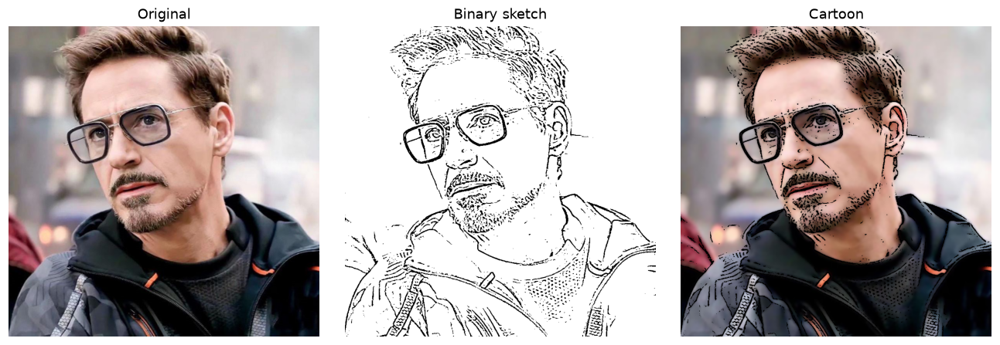
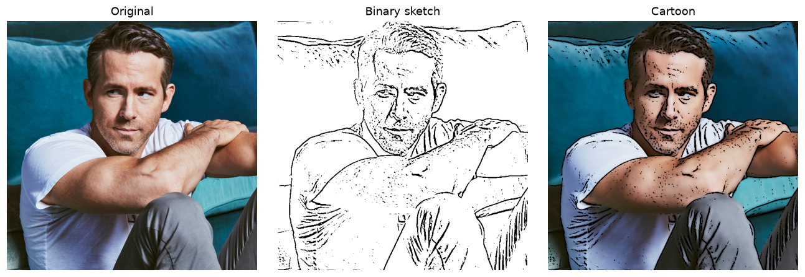

# 01 — Image Cartoonifier

Classical image-processing pipeline that turns a real-world photo into a
cartoon-style image — no machine learning, just filtering.



## Approach

1. **Binary sketch** — convert to grayscale → median blur (denoising while
   preserving edges) → Laplacian edge detection → binary threshold.
2. **Color painting** — strong bilateral filter (`d=9`, `σColor=σSpace=250`)
   flattens flat regions while keeping edges intact.
3. **Overlay** — the sketch is used as a mask over the painting
   (`cv2.bitwise_and`), producing the cartoon effect.



## Files

| Path | Contents |
|---|---|
| `cartoonifier.ipynb` | The full pipeline, run over every image in `assets/` |
| `assets/` | Sample input photos |
| `outputs/` | Original → sketch → cartoon for every bundled asset |

## Running

```bash
pip install -r ../../requirements.txt   # from repo root works too
jupyter notebook cartoonifier.ipynb
```


