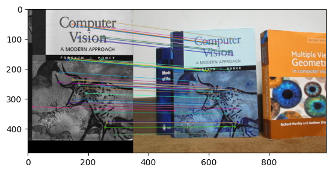
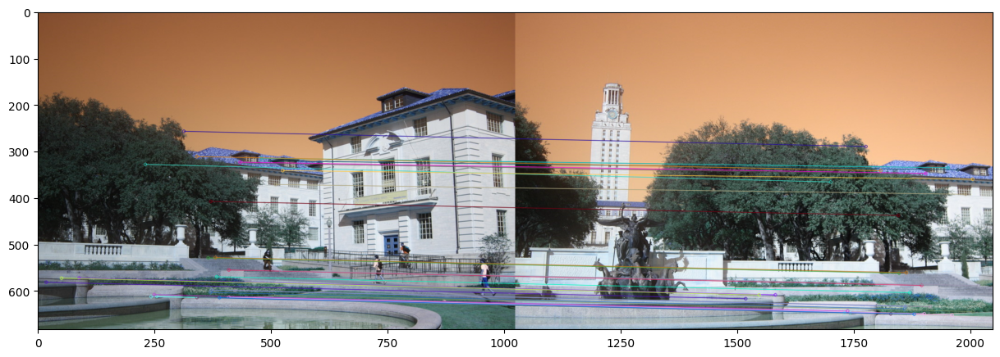

# 02 — Planar Homographies: AR Overlay & Image Mosaics

Two applications built on homographies estimated **from scratch**
(the 3×3 `H` is solved as the null-space of the homogeneous `A·h = 0`
system via SVD — i.e. DLT — then compared against `cv2.findHomography`
for verification).

## Part 1 — Augmented-reality video overlay

Each frame of a source video is projected onto the cover of a book tracked in
another video:


Pipeline:

1. SIFT keypoints + brute-force KNN matching with ratio test (top 50 matches
   for the cover still, top 30 per video frame).
2. Homography between the book cover and each video frame (custom solver).
3. Map the book's four corners into the frame via `cv2.perspectiveTransform`.
4. Center-crop each AR frame to the book's aspect ratio, warp it with
   `cv2.warpPerspective`, and blend with a convex-polygon mask.



## Part 2 — Image mosaics (panorama stitching)

Two-view stitching with inverse warping, plus a 3-view attempt on the
Shanghai skyline images: matching and the first-pair mosaic succeed, but the
final merge exposes a canvas-size edge case in `create_mosaic` (the paste
slice assumes both inputs share dimensions) — the traceback is left visible
in the notebook.

| SIFT matches | Stitched mosaic |
|---|---|
|  |  |

## Files

| Path | Contents |
|---|---|
| `part1_ar_overlay.ipynb` | AR video overlay |
| `part2_image_mosaics.ipynb` | 2-view mosaic + 3-view stitch attempt (final merge hits a `create_mosaic` edge case) |
| `assets/` | `book.mov`, `ar_source.mov`, `cv_cover.jpg`, panorama & Shanghai image sets |
| `outputs/` | Match visualizations, stitched results, AR demo GIF |

## Running

```bash
pip install -r ../../requirements.txt
jupyter notebook part1_ar_overlay.ipynb   # or part2_image_mosaics.ipynb
```

Part 1 writes the rendered video to `outputs/ar_output.avi` (video files are
git-ignored).

