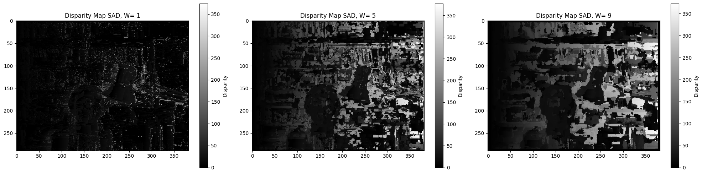
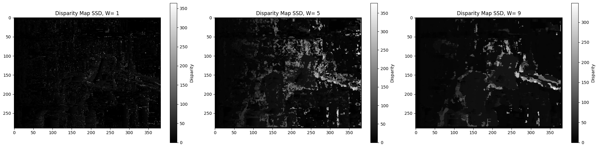
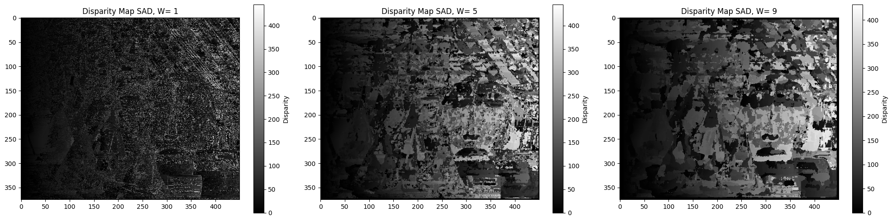
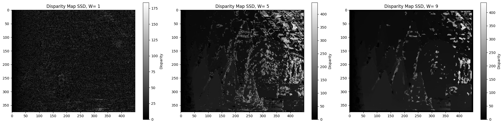
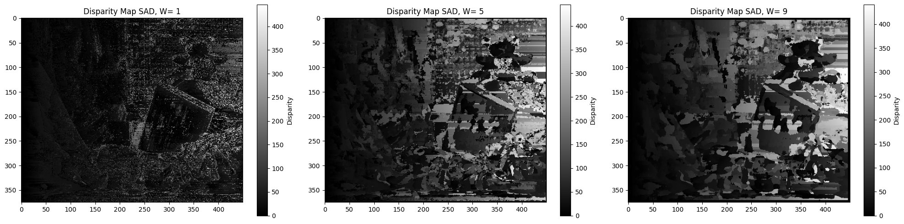
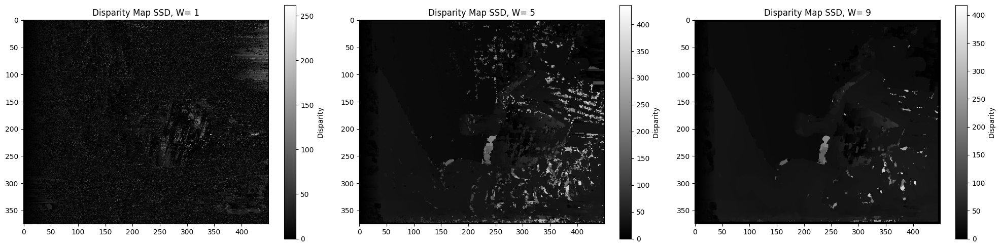
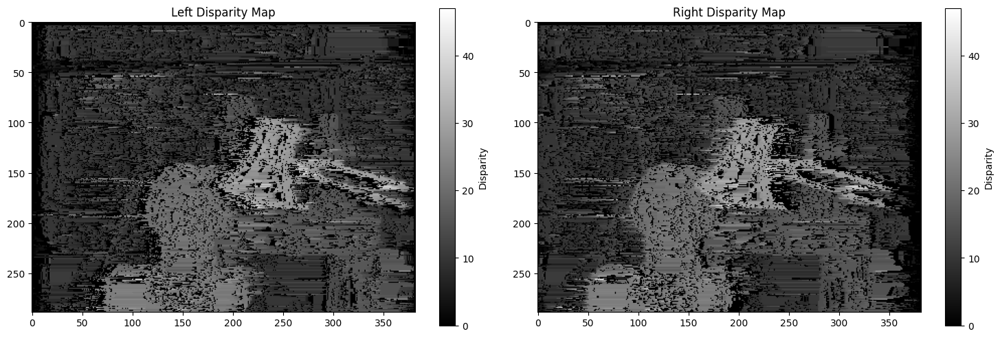
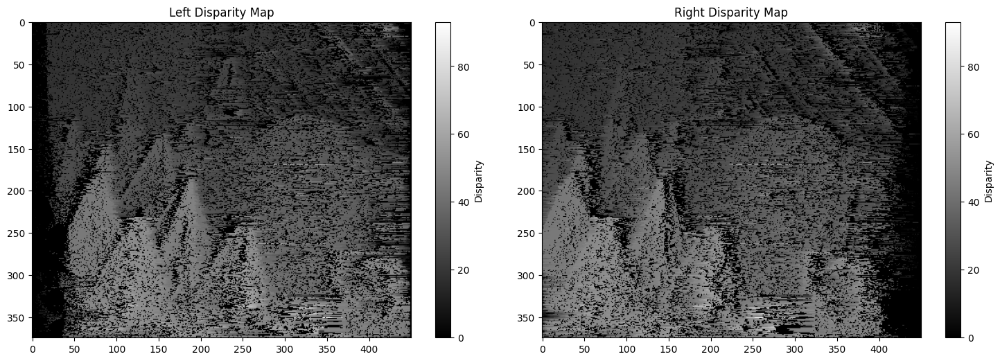
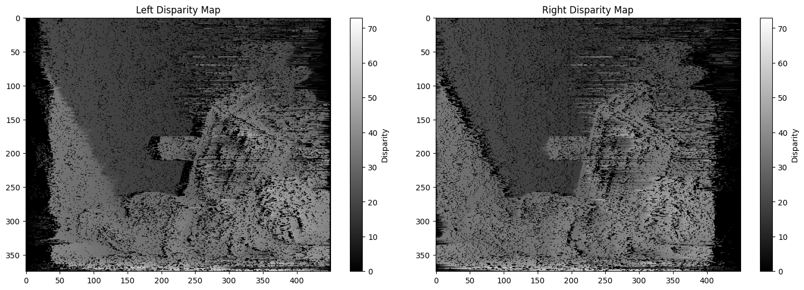
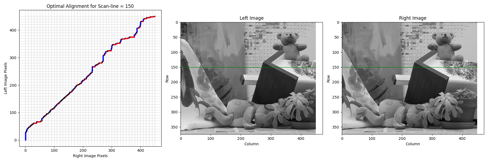

# 03 — Stereo Disparity Estimation

Baseline stereo: compute the horizontal disparity between a left/right image
pair two different ways — both implemented from scratch.


## Block matching

Each pixel window in the left image is matched against candidate windows on
the same scanline in the right image, using two cost functions:

- **SAD** — sum of absolute differences
- **SSD** — sum of squared differences

evaluated at window sizes `w ∈ {1, 5, 9}` (6 disparity maps per pair). Larger
windows trade noise for blurrier boundaries — visible across the three maps
below:

| Pair | SAD | SSD |
|---|---|---|
| 1 |  |  |
| 2 |  |  |
| 3 |  |  |

## Dynamic programming

Per-scanline optimal alignment with occlusion handling: pixels may be matched
(cost `d_ij = (I_l(i) − I_r(j))² / σ²`) or skipped (constant cost `c₀`), solved
with the classic `D(i,j)` recurrence and backtracked to recover the disparity
maps for both views:

| Pair | Left + right disparity maps |
|---|---|
| 1 |  |
| 2 |  |
| 3 |  |

Includes the bonus visualization — the optimal alignment path through the
cost matrix for a single scanline (diagonal = match, horizontal/vertical =
occlusion skip):



## Files

| Path | Contents |
|---|---|
| `stereo_disparity.ipynb` | Block matching + DP, run on all three stereo pairs |
| `assets/` | `l1–l3.png`, `r1–r3.png` stereo pairs |
| `outputs/` | Disparity maps and alignment plots — `pair{N}_{sad,ssd,dp}.png` |

## Running

```bash
pip install -r ../../requirements.txt
jupyter notebook stereo_disparity.ipynb
```

Note: block matching is implemented as an explicit per-pixel search — it's
instructive but slow (tens of seconds per map).
