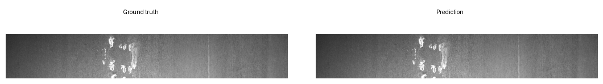
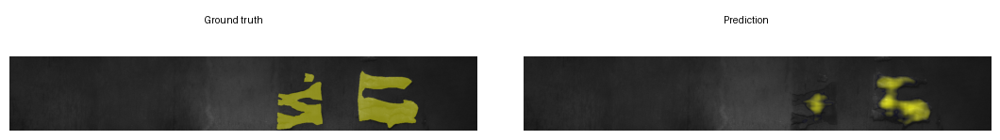
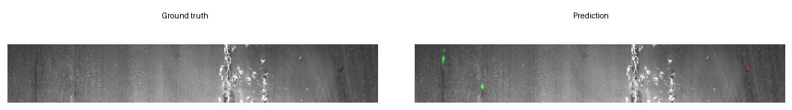
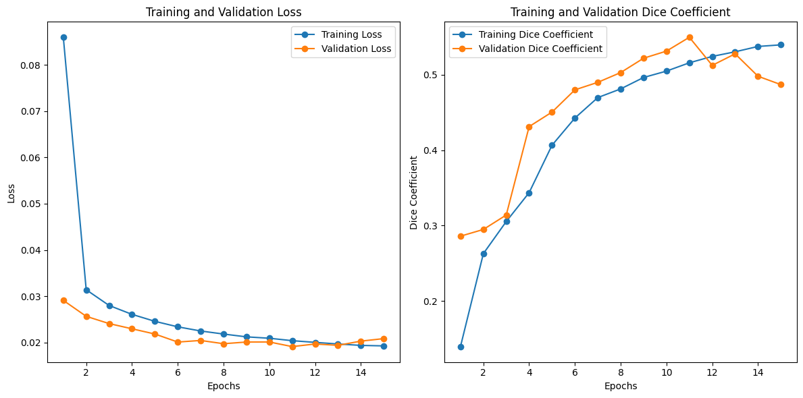

# 05 — Steel Surface Defect Segmentation

Semantic segmentation of manufacturing defects on steel surfaces — from the
[Severstal Steel Defect Detection](https://www.kaggle.com/c/severstal-steel-defect-detection)
Kaggle competition (4 defect classes, run-length-encoded masks).

Same validation image — annotated defect mask vs. model prediction:




A typical failure mode — the model localizes the defect but under-segments it:



Another failure mode — false-positive defects on a clean surface:



## What's inside

- **RLE → mask pipeline** — decodes the competition's run-length encodings
  (1-indexed start/length pairs reshaped column-major), then rebalances the
  training set by dropping empty images and dominant class-3-only samples
  (cap of 6,000 dropped rows).
- **U-Net + ResNet encoder** — a hand-built `UNetResNet` (torchvision ResNet
  encoder + ConvTranspose2d decoder blocks with skip connections) is defined
  in the notebook; the trained model uses the identically-named
  `segmentation_models_pytorch` wrapper (`smp.Unet`, ResNet-50 encoder,
  ImageNet weights, encoder frozen).
- **Architecture comparison** — `UNetPlusPlusResNet`, `PSPNetResNet`, and
  `FPNResNet` variants defined alongside (via `segmentation_models_pytorch`,
  frozen encoders).
- **Metrics** — Dice coefficient and mIoU tracked per epoch; metric history
  is saved to `training_metrics_UnetResNet50.pt` so curves accumulate across
  resumed runs (model weights are checkpointed separately as
  `UnetRES50_model_epoch_*.pth`).

## Results (15 epochs)

Final epoch, with validation peak in parentheses:

| Metric | Train | Validation |
|---|---|---|
| mIoU | ~0.38 | ~0.34 (peak ~0.39) |
| Dice | ~0.55 | ~0.48 (peak ~0.55) |



## Running

Designed for Kaggle notebooks (GPU quota + the competition dataset mounted at
`/kaggle/input/severstal-steel-defect-detection`). Locally:

```bash
pip install -r ../../requirements.txt
jupyter notebook steel_defect_segmentation.ipynb
```

Download the dataset via the competition page or
`kaggle competitions download -c severstal-steel-defect-detection`, then point
the paths in the first cells at your copy.

## Credits

Built by [Mahmoud Haytham](https://github.com/mahmoudhaytham25) and
[Mahmoud Al-Zamly](https://github.com/MahmoudElzamly25).
