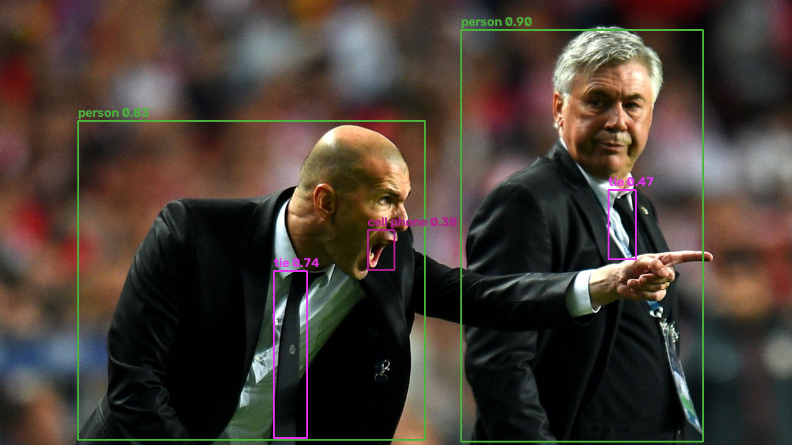

# YOLOv5 From Scratch

A from-scratch PyTorch reimplementation of **YOLOv5s** — no `ultralytics`
import anywhere. The notebook builds the CSP-Darknet backbone, PANet neck,
and anchor-based detection head layer by layer, then implements decoding and
non-max-suppression by hand.

**Proof it matches the real thing:** the hand-assembled model has exactly
7,235,389 parameters, and the official pretrained `yolov5s.pt` `state_dict`
transfers into it with **zero missing and zero unexpected keys** — it then
reproduces the canonical reference detections.

## What's implemented

- **Building blocks** — `Conv` (Conv+BN+SiLU), `Bottleneck`, `C3` (CSP
  bottleneck with 3 convs), `SPPF` (serial 5×5 max-pool pyramid), `Concat`
- **Model graph** — 25 layers wired per `yolov5s.yaml` with
  `width_multiple=0.50` / `depth_multiple=0.33`; each layer carries a
  `from`-index so PANet skip connections route correctly
- **Detection head** — per-scale `1×1` convs producing `na × (5 + nc)` raw
  predictions; sigmoid/grid decode
  (`xy = (2σ−0.5+grid)·stride`, `wh = (2σ)²·anchor`)
- **Post-processing** — IoU computation and greedy class-aware NMS, both
  from scratch
- **Checkpoint compatibility** — a `sys.modules` shim lets the official
  `.pt` file unpickle directly into these classes, followed by a strict
  state-dict transfer into the hand-built model

## Results

| Image | Top detections |
|---|---|
| `zidane.jpg` | person 0.90, person 0.83, tie 0.74, tie 0.47 |
| `bus.jpg` | 4× person, bus 0.79 (+ parking meter, fire hydrant at lower conf) |
| `tstark.jpg` / `rr.jpg` / `ew.jpg` | person detections; `rr.jpg` shows an honest edge-case false positive |

| | |
|---|---|
|  |  |

## Files

- `yolov5_from_scratch.ipynb` — the full implementation, executed end-to-end
- `assets/` — demo images (`yolov5s.pt` is downloaded here automatically at
  runtime, ~14 MB, not committed)
- `outputs/` — annotated detections saved by the notebook

## Running

```bash
pip install -r ../../requirements.txt
jupyter notebook yolov5_from_scratch.ipynb
```

The notebook downloads the official checkpoint from the ultralytics
[v7.0 release](https://github.com/ultralytics/yolov5/releases/tag/v7.0)
on first run. Runs on CPU; ~7M-param inference is fast.

## Training notes

The architecture trains with the standard YOLOv5 recipe: CIoU box loss,
BCE objectness (IoU-scaled) and classification losses, and scale-aware
anchor-ratio target assignment. The notebook scopes itself to architecture +
weight-compatibility + inference — a full COCO training run needs a GPU
budget and labeled data.
