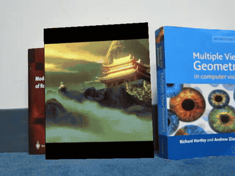
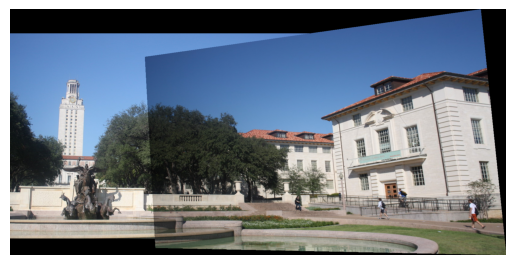
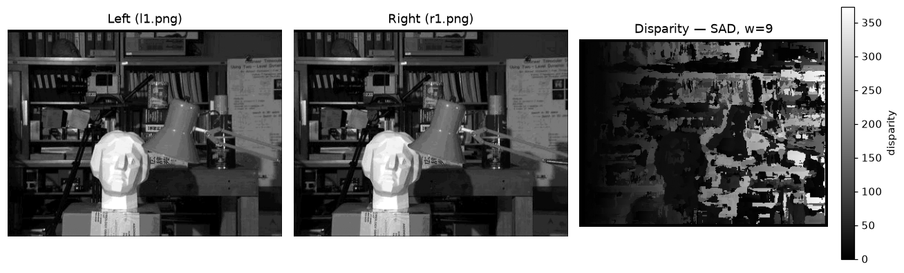
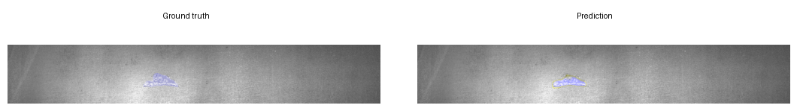
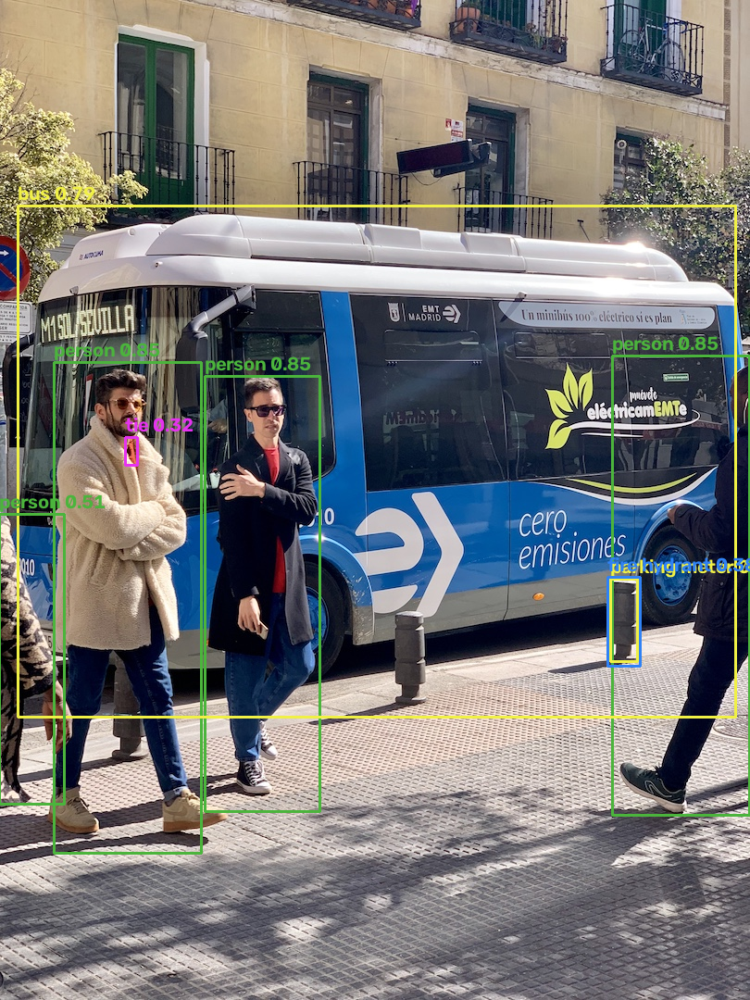

# Computer Vision Projects

[](LICENSE)


A collection of computer-vision projects — from classical OpenCV pipelines to
CNN architectures implemented from scratch in PyTorch.

| # | Project | Techniques | |
|---|---|---|---|
| 01 | [Image Cartoonifier](01-image-cartoonifier/) | Median/Laplacian/bilateral filtering, thresholding, masking | [notebook](01-image-cartoonifier/cartoonifier.ipynb) |
| 02 | [AR Overlay & Image Mosaics](02-homography-ar-mosaics/) | SIFT, KNN ratio test, homography solved from scratch (SVD), perspective warping, video overlay, panorama stitching | [part 1](02-homography-ar-mosaics/part1_ar_overlay.ipynb) · [part 2](02-homography-ar-mosaics/part2_image_mosaics.ipynb) |
| 03 | [Stereo Disparity](03-stereo-disparity/) | Block matching (SAD/SSD), dynamic-programming scanline alignment with occlusion handling | [notebook](03-stereo-disparity/stereo_disparity.ipynb) |
| 04 | [CNNs From Scratch](04-cnn-from-scratch/) | VGG-16 & DenseNet-121 hand-built in PyTorch, custom augmentation, dropout ablation | [notebooks](04-cnn-from-scratch/) |
| 05 | [Steel Defect Segmentation](05-steel-defect-segmentation/) | Semantic segmentation, U-Net with ResNet-50 encoder built from scratch, UNet++/PSPNet/FPN variants, Dice & mIoU, RLE mask decoding | [notebook](05-steel-defect-segmentation/steel_defect_segmentation.ipynb) |
| 06 | [YOLOv5 From Scratch](06-yolov5-from-scratch/) | CSP-Darknet backbone, PANet neck, anchor-based head, hand-written decode & NMS — verified state-dict-compatible with the official `yolov5s` checkpoint | [notebook](06-yolov5-from-scratch/yolov5_from_scratch.ipynb) |

## Highlights

**Augmented-reality overlay** — a source video projected onto a book tracked
frame-by-frame via SIFT + homography:



**Panorama stitching** — SIFT correspondences → from-scratch homography →
inverse-warped mosaic:



**Stereo disparity** — left/right pair → block-matched disparity map:



**Steel defect segmentation** — ground truth vs. U-Net prediction, same image:



**YOLOv5 from scratch** — hand-built architecture running the official
`yolov5s` weights (state dict transfers with zero missing/extra keys):



## Setup

```bash
python -m venv .venv && source .venv/bin/activate
pip install -r requirements.txt
```

Each project folder has its own README with details, demo outputs, and run
instructions. Datasets/assets needed at runtime are bundled under each
project's `assets/` (projects 04 and 05 download their datasets from Kaggle —
see their READMEs).

## Notes

- Rendered videos (`outputs/*.mp4|avi|mov`) are git-ignored to keep the repo
  light.

## Credits

- **[Mahmoud Haytham](https://github.com/mahmoudhaytham25)** — all projects
- **[Mahmoud Al-Zamly](https://github.com/MahmoudElzamly25)** — project 05
  collaborator
